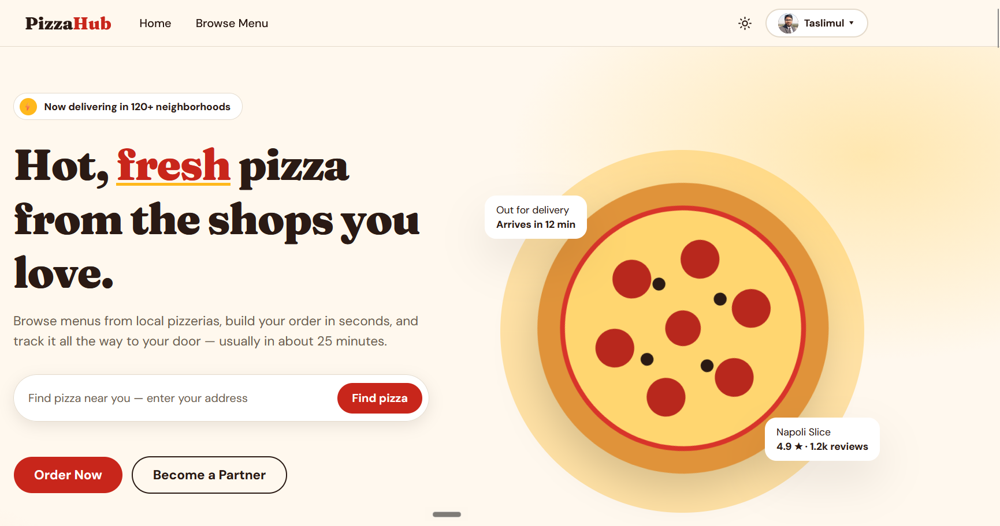

<div align="center">

# 🍕 PizzaHub — Client

**Hot & fresh pizza from local kitchens, delivered to your door.**

A role-based pizza ordering and delivery platform. Customers discover local pizza shops and order food, restaurants (vendors) publish menus and manage orders, and admins keep the marketplace safe.

[Live site](#-links) · [Server repository](https://github.com/taslimul6/Pizza-Pulse-Server) · [Report a bug](https://github.com/taslimul6/Pizza-Pulse/issues)


<br />



</div>

---

## 📑 Table of contents

1. [Links](#-links)
2. [About the project](#-about-the-project)
3. [Features](#-features)
4. [Challenge requirements — how they were built](#-challenge-requirements--how-they-were-built)
5. [Tech stack](#-tech-stack)
6. [Pages and routes](#-pages-and-routes)
7. [Project structure](#-project-structure)
8. [Getting started](#-getting-started)
9. [Environment variables](#-environment-variables)
10. [Security](#-security)
11. [Scripts](#-scripts)

---

## 🔗 Links

| | |
| --- | --- |
| **Live website** | _add the client URL after deployment_ |
| **Live API** | _add the server URL after deployment_ |
| **Client repository** | https://github.com/taslimul6/Pizza-Pulse |
| **Server repository** | https://github.com/taslimul6/Pizza-Pulse-Server |
| **Admin demo login** | _add the admin email / password for reviewers_ |

---

## 🍕 About the project

PizzaHub is a complete, realistic marketplace built with the Next.js App Router. It is not a set of static pages: every list, form and dashboard talks to a real Express + MongoDB API, protected with JWTs and role checks on the server.

| Role | What they can do |
| --- | --- |
| **Customer** | Browse, search, filter and sort menu items, view item details, order with a delivery date and address, track the order status on a timeline, cancel pending orders, manage their profile. |
| **Vendor (restaurant)** | Manage the restaurant profile, add / update / delete menu items (photos on ImgBB), switch items on or off, accept or reject customer orders, upgrade to **Premium** with Stripe. |
| **Admin** | See platform statistics, manage users (search, filter, block / unblock), review menu items (approve, reject, unpublish, delete), view read-only transactions. |

**Premium vendors** get unlimited menu items, a ⭐ Premium vendor badge and featured placement on the home page.

---

## ✨ Features

### Authentication and access
- **Better Auth** with email + password and **Google** sign in, users stored in MongoDB.
- Sign up as **Customer** or **Restaurant**. Password rule: at least 6 characters, one uppercase and one lowercase letter (checked in the form *and* on the server).
- **Admin accounts can't be created through public sign up.** Admins are created on a separate, unlinked page (`/auth/admin`) that needs a secret key from the environment.
- Route protection in `proxy.ts`: guests are sent to Sign In (and returned to the page they wanted after login), each dashboard only opens for its own role.
- **Blocked users** are logged out immediately, can't sign in again (email or Google) and see a toast explaining why.
- The navbar updates right after sign in / sign out and shows the user's photo, a Dashboard link, Profile Settings and Logout.

### Browsing and ordering
- **Browse Menu** (public) with **server-side** search, category / location / price filters and **price sorting** (ascending / descending). The filters live in the URL, so results can be shared and reloaded.
- **Item details** (`/menu/[id]`, logged-in users only) with photos, category, description, price, location and vendor info.
- **Order form** with delivery date, delivery address and a message for the restaurant. Customer, vendor and item are detected automatically.
- Business rules enforced by the API: only approved items can be ordered, vendors can't order their own items, **no duplicate active orders** for the same item and delivery date.
- **Order status timeline** (Placed → Accepted → Delivered, or Rejected / Cancelled) on the order details page.

### Dashboards (sidebar layout, fully responsive)
- **Customer:** overview with KPIs, recent orders and suggestions; My Orders with details, timeline and cancel; Profile settings.
- **Vendor:** overview (menu items, live items, new and accepted orders, plan); My Menu Items (view, update, delete, availability switch); Add Menu Item with ImgBB upload; Customer Orders (accept / reject once, complete); Subscription; Profile settings (restaurant name and photo).
- **Admin:** overview with KPIs, recent transactions, user mix and menu health; Manage Users; Manage Menu Items; Transactions (read-only); Profile settings.

### Subscriptions and payments
- **Free plan:** up to 3 menu items. **Premium:** unlimited items, Premium badge, featured placement.
- **Stripe Checkout** for the Premium upgrade. The server creates the Checkout Session for the logged-in vendor only, and Premium is granted after the payment is verified with Stripe on the server (never from the browser redirect alone). Each Stripe session can be used once.
- Customer orders use a simple order button (no card payment), as required.

### UI / UX
- Warm pizza theme (tomato red, basil green, cheese gold, espresso, cream) with **Fraunces** headings and **DM Sans** body text.
- **Dark / light mode** toggle (follows the device setting until changed).
- shadcn/ui components, reusable dashboard building blocks, loading skeletons, empty states and toast notifications everywhere (no `alert()`).

---

## 🏆 Challenge requirements — how they were built

### 1. Advanced search and price sorting

The Browse Menu page keeps every filter in the address bar, and the **server** does the searching and sorting.

```
/menu?search=pepperoni&category=classic-pizzas&location=Downtown&minPrice=5&maxPrice=20&sort=price_asc
```

1. `app/menu/page.tsx` (a Server Component) reads `searchParams`, validates them and calls the API:
   `GET {API_URL}/menu?search=…&category=…&location=…&minPrice=…&maxPrice=…&sort=…`
2. The Express route builds a MongoDB query: a case-insensitive, regex-escaped `$or` on `itemName` and `description`, exact `category` and `location` matches, a `price` range and a whitelisted sort (`newest`, `price_asc`, `price_desc`, `rating`). Bad values get a `400`.
3. `app/components/menu/MenuBrowse.tsx` (Client Component) updates the URL with `router.replace` inside `startTransition` (search is debounced by 400 ms), so the page re-renders on the server while the old results stay visible with an "Updating results…" indicator.

### 2. JWT verification

1. Better Auth's **JWT plugin** (`lib/auth.ts`) signs a short-lived **EdDSA** token (15 minutes) for the logged-in user and publishes the public keys at `/api/auth/jwks`.
2. The token never reaches the browser. Next.js route handlers and server components get it with `getAuthToken()` / `authFetch()` (`lib/api-auth.ts`) and send `Authorization: Bearer <token>` to the API.
3. The API middleware verifies the signature, issuer, audience and expiry, loads the user from the database (rejecting deleted or blocked users) and then checks the role with `requireRole(...)`. Invalid or expired tokens get `401`, wrong roles get `403`.

See the [server README](https://github.com/taslimul6/Pizza-Pulse-Server#-jwt-verification-middleware-flow) for the middleware details.

---

## 🧰 Tech stack

| Area | Tools |
| --- | --- |
| Framework | **Next.js 16** (App Router, Cache Components, `proxy.ts`), **React 19**, **TypeScript** |
| Styling / UI | **Tailwind CSS 4**, **shadcn/ui** on **Base UI**, `lucide-react` icons, `tw-animate-css` |
| Auth | **Better Auth** (email, Google OAuth, JWT plugin) + `@better-auth/mongo-adapter` |
| Data | **MongoDB** (Better Auth collections), Express API for business data |
| Payments | **Stripe Checkout** (vendor subscriptions only, handled by the server) |
| Images | **ImgBB** API |
| UX | `sonner` toasts, `next-themes` dark mode |

### npm packages

**Dependencies:** `next`, `react`, `react-dom`, `better-auth`, `@better-auth/mongo-adapter`, `mongodb`, `@base-ui/react`, `shadcn`, `class-variance-authority`, `cn`, `lucide-react`, `next-themes`, `sonner`, `tw-animate-css`

**Dev dependencies:** `typescript`, `tailwindcss`, `@tailwindcss/turbopack`, `eslint`, `eslint-config-next`, `@types/node`, `@types/react`, `@types/react-dom`

---

## 🗺️ Pages and routes

| Type | Routes |
| --- | --- |
| Public | `/` Home, `/menu` Browse Menu, `/signin`, `/signup` |
| Private (any logged-in user) | `/menu/[id]` Item details, `/settings` (redirects to your dashboard's settings) |
| Customer | `/customer`, `/customer/myorder`, `/customer/myorder/[id]`, `/customer/settings` |
| Vendor | `/vendor`, `/vendor/manage`, `/vendor/addMenu`, `/vendor/orders`, `/vendor/subscription`, `/vendor/settings` |
| Admin | `/admin`, `/admin/users`, `/admin/menu-review`, `/admin/transactions`, `/admin/settings` |
| Admin sign up (unlinked) | `/auth/admin` — needs `ADMIN_SIGNUP_KEY` |

Route handlers (`app/api/*`) are a thin, authenticated layer in front of the Express API: `orders`, `menu`, `admin/menu`, `users`, `profile`, `subscription`, `admin-signup` and Better Auth's `auth/[...all]`.

---

## 📁 Project structure

```
pizza-hub/
├── app/
│   ├── page.tsx                # Home page
│   ├── layout.tsx              # Root layout (navbar, footer, theme, toasts)
│   ├── menu/                   # Browse Menu + item details
│   ├── customer/ vendor/ admin/# Role dashboards (each with layout.tsx + sidebar)
│   ├── auth/admin/             # Secret admin sign up
│   ├── signin/ signup/
│   ├── api/                    # Route handlers that call the Express API with a JWT
│   └── components/             # Page components (homepage, menu, dashboard, vendor, admin, customer, shared)
├── components/ui/              # shadcn/ui components
├── lib/                        # auth, api clients, validation, formatting helpers
├── types/                      # Shared TypeScript types
└── proxy.ts                    # Route protection and role redirects
```

---

## 🚀 Getting started

### Prerequisites
- **Node.js 20+** and npm
- A **MongoDB** database (Atlas works)
- The **[PizzaHub server](https://github.com/taslimul6/Pizza-Pulse-Server)** running (default `http://localhost:5000`)
- Accounts for **Google OAuth**, **ImgBB** and **Stripe** (test mode)

### Installation

```bash
git clone https://github.com/taslimul6/Pizza-Pulse.git
cd Pizza-Pulse
npm install
cp .env.example .env     # then fill in the values (see below)
```

### Run locally

```bash
# 1. start the API first (in the server folder)
npm run dev               # http://localhost:5000

# 2. start the client
npm run dev               # http://localhost:3000
```

### Create an admin
Open `http://localhost:3000/auth/admin` and use the `ADMIN_SIGNUP_KEY` from your `.env`.

---

## 🔐 Environment variables

Create `.env` from `.env.example`. **Never commit `.env`.**

| Variable | Required | Description |
| --- | --- | --- |
| `BETTER_AUTH_SECRET` | ✅ | Secret that signs sessions (`npx @better-auth/cli secret`) |
| `BETTER_AUTH_URL` | ✅ | Public URL of the client (also the JWT issuer / audience) |
| `MONGODB_URI` | ✅ | MongoDB connection string |
| `GOOGLE_CLIENT_ID` | ✅ | Google OAuth client ID |
| `GOOGLE_CLIENT_SECRET` | ✅ | Google OAuth client secret |
| `API_URL` | ✅ | Base URL of the Express API (with trailing `/`) |
| `FEATURED_API_URL` | ✅ | `{API_URL}featured`, used by the home page |
| `IMGBB_API_KEY` | ✅ | ImgBB key for menu and profile photos |
| `ADMIN_SIGNUP_KEY` | ✅ | Secret needed on `/auth/admin` to create admins |
| `NEXT_PUBLIC_STRIPE_PUBLISHABLE_KEY` | ➖ | Stripe publishable key (optional, Checkout is a redirect) |

Google OAuth redirect URI: `{BETTER_AUTH_URL}/api/auth/callback/google`

---

## 🛡️ Security

- Every secret (Better Auth, MongoDB, Google, ImgBB, Stripe, admin key) comes from environment variables. `.env` files are gitignored.
- Role checks happen on the **server** (proxy + route handlers + the API's `requireRole`), not only by hiding links.
- The client never sends user ids or roles to the API. The API reads them from the verified JWT.
- Profile updates can't change `role`, `isBlocked` or the subscription (blocked in a Better Auth hook).
- Card details are never sent to PizzaHub: Premium is paid on Stripe's own page.

---

## 📜 Scripts

| Command | What it does |
| --- | --- |
| `npm run dev` | Start the development server |
| `npm run build` | Production build |
| `npm run start` | Serve the production build |
| `npm run lint` | Run ESLint |
| `npx tsc --noEmit` | Type check |

---

<div align="center">

Made with 🍕 by **Taslimul Hasan**

</div>
